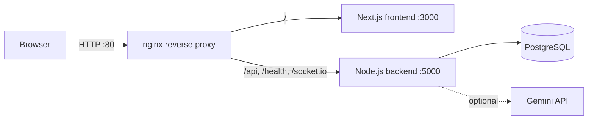
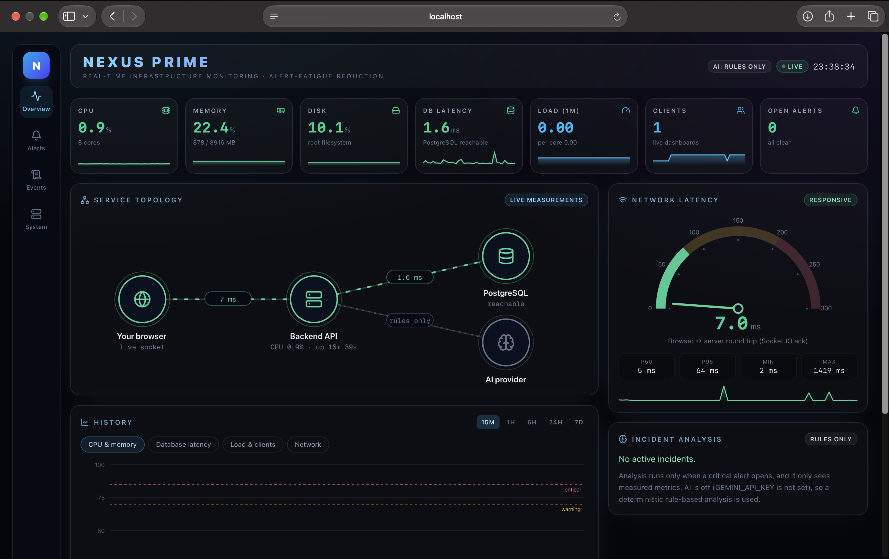
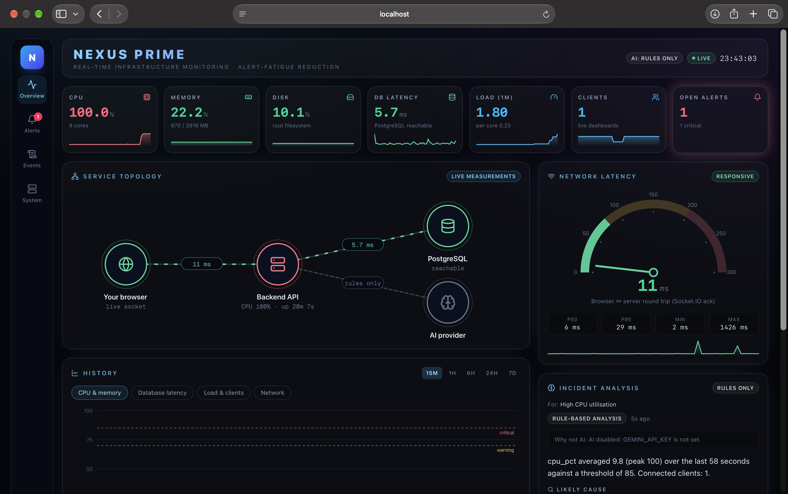
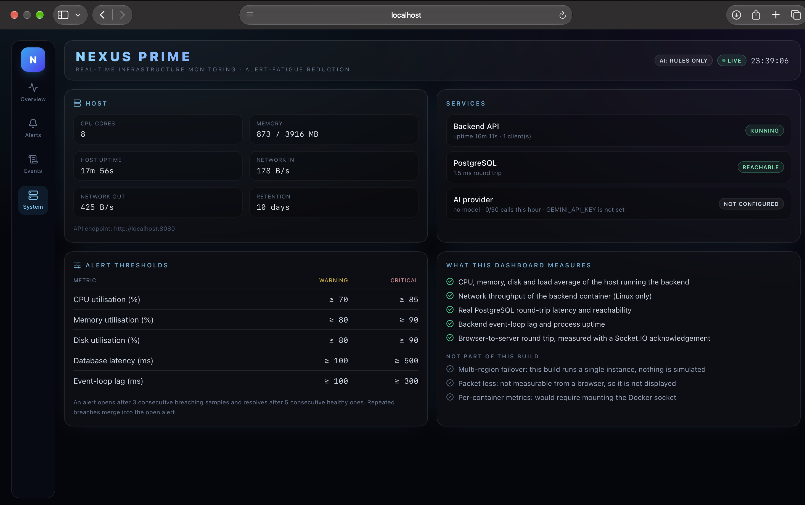

# Nexus Prime


**Real-time infrastructure monitoring that fights alert fatigue.**

Small teams running payment or e-commerce services get buried in repeated alerts, and the one that matters gets missed.
Nexus Prime watches a host in real time and turns a stream of threshold breaches into a small number of meaningful incidents.

> Built for the TrainWithShubham **#BuildOnElasticBeanstalk** hackathon.

## What it does

- **Real metrics, no simulation.** CPU, memory, disk, load, network, database latency and Node.js event-loop lag are measured on the host that runs the backend. Browser-to-server round-trip time is measured over the live Socket.IO connection.
- **Alert-fatigue reduction.** An alert opens only after 3 consecutive bad samples and resolves only after 5 good ones. Repeats are merged into one alert and severity escalates instead of re-alerting. The Alerts tab shows how many breaches were merged into how many alerts.
- **Evidence-grounded AI analysis (optional).** For any incident, Gemini (via LangChain) is asked for a structured explanation using only the recorded evidence. Answers that cite numbers not present in the evidence are rejected. If no API key is set or the model is unavailable, a clearly labelled **rules-only** analysis is shown instead.
- **Live dashboard.** Animated KPI strip, ping gauge, service topology (browser, backend, PostgreSQL, AI, all measured), history charts from 15 minutes to 7 days, incident drawer with acknowledge and evidence table, and a searchable live event log.
- **Honest scope.** The System tab lists what is and is not measured.

## Architecture



nginx is the single public entry point. The browser talks to one origin, so there is no CORS setup and WebSockets pass through the same port. This is also the layout Elastic Beanstalk expects for Docker Compose applications.

## Tech stack

| Layer | Technology |
|---|---|
| Frontend | Next.js (App Router), React, Tailwind CSS 4, Framer Motion, Recharts |
| Backend | Node.js, Express, Socket.IO |
| Database | PostgreSQL 15 |
| AI (optional) | Google Gemini through LangChain |
| Proxy | nginx |
| Containers | Docker, Docker Compose (multi-stage builds, non-root users, healthchecks) |
| Deployment | AWS Elastic Beanstalk (Docker platform, single instance) |
| CI | GitHub Actions |

## Run it locally

Requirements: Docker with Docker Compose.

```bash
cp .env.example .env        # then set POSTGRES_PASSWORD to a long random value
docker compose up --build
```

Open **http://localhost:8080**.

## Configuration

All settings are environment variables (see `.env.example`).

| Variable | Purpose | Default |
|---|---|---|
| `POSTGRES_USER`, `POSTGRES_PASSWORD`, `POSTGRES_DB` | Database credentials (use URL-safe characters) | required |
| `ADMIN_TOKEN` | Protects acknowledge, explain and AI-test endpoints | empty (open) |
| `GEMINI_API_KEY`, `GEMINI_MODEL` | Enable AI analysis. Without them the app runs in rules-only mode | empty |
| `AI_MAX_CALLS_PER_HOUR` | Rate limit for AI calls | 30 |
| `RETENTION_DAYS` | How long samples and alerts are kept | 10 |
| `CPU_WARN`, `CPU_CRIT`, `MEM_WARN`, `MEM_CRIT`, `DISK_WARN`, `DISK_CRIT`, `DB_LAT_WARN`, `DB_LAT_CRIT`, `LOOP_WARN`, `LOOP_CRIT` | Alert thresholds | 70/85, 80/90, 80/90, 100/500, 100/300 |
| `ALERT_TRIGGER_SAMPLES`, `ALERT_RESOLVE_SAMPLES` | Consecutive samples to open and resolve an alert | 3 and 5 |

## API

| Endpoint | Description |
|---|---|
| `GET /health` | Liveness probe |
| `GET /api/health` | Service, database and AI status |
| `GET /api/summary` | Latest sample, open alerts, noise reduction, thresholds |
| `GET /api/metrics?range=` | Metric history |
| `GET /api/alerts`, `GET /api/alerts/:id` | Alert list and incident detail with evidence |
| `POST /api/alerts/:id/ack` | Acknowledge (admin token if set) |
| `POST /api/alerts/:id/explain` | On-demand AI or rules-only analysis (admin token if set) |
| `GET /api/ai/status`, `POST /api/ai/test` | AI availability and test call |

Socket.IO events: `hello`, `telemetry`, `alert_update`, `ai_analysis`, `log_event`.

## Deploy to AWS Elastic Beanstalk

```bash
docker login
bash deploy/build-and-push.sh v2      # builds linux/amd64 images and pushes them to Docker Hub
bash deploy/make-eb-bundle.sh         # creates dist/nexus-eb.zip
```

Upload `dist/nexus-eb.zip` to a new Elastic Beanstalk environment (Docker platform, single instance, `t3.small`) and set the environment properties `POSTGRES_PASSWORD` and `ADMIN_TOKEN` (and optionally `GEMINI_API_KEY`, `GEMINI_MODEL`). Full steps with screenshots are in [`docs/DEVOPS-JOURNEY.md`](docs/DEVOPS-JOURNEY.md).

## Project structure

```
backend/      Node.js API, collector, alert engine, AI controller
frontend/     Next.js dashboard
nginx/        Reverse proxy image and config
deploy/       Image build script, Beanstalk bundle script, Beanstalk compose and platform hook
docs/         DevOps walkthrough and submission material
docker-compose.yml   Local stack (builds from source)
```

## Known limitations

- Monitors **one host** (the one running the backend). No multi-host agents yet.
- No external endpoint checks, packet-loss measurement or multi-region failover.
- No automated test suite yet. CI currently checks that both apps build and that all images build.
- AI analysis needs your own Gemini key and model ID.

## Roadmap

- Synthetic external endpoint checks (for example, a payment API health probe)
- Automated deployment from GitHub Actions
- Backend unit and integration tests
- Lightweight agents for multi-host monitoring

## Screenshots

| Live dashboard | Incident with evidence |
|---|---|
|  |  |

| System tab (what is measured) | Running on AWS Elastic Beanstalk |
|---|---|
|  |  |
